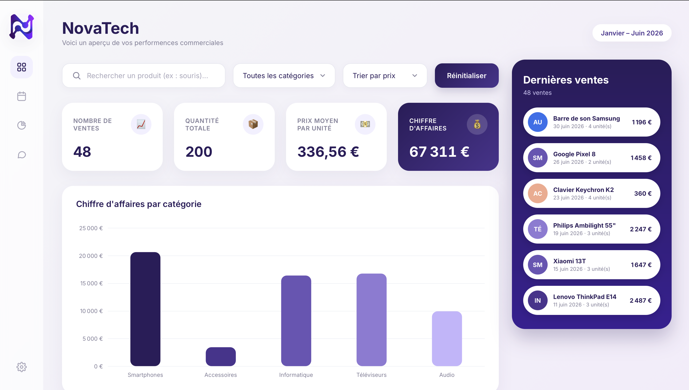

# NovaTech – Sales Dashboard

Tableau de bord des ventes interactif, développé en HTML, CSS et JavaScript avec Chart.js pour la conception des graphiques. 
Ce projet a été réalisé pour mon portfolio, dans le but de mettre en application les acquis de ma formation.

🔗 **Démo en ligne : [https://myriam-akrt.github.io/sales-dashboard/](https://myriam-akrt.github.io/sales-dashboard/)**



## Fonctionnalités

- **4 indicateurs clés (KPI)** : nombre de ventes, quantité totale, prix moyen par unité, chiffre d'affaires
- **3 graphiques Chart.js** : CA par catégorie (barres), évolution du CA et des ventes par mois (courbe), quantités par catégorie (anneau)
- **Tableau dynamique** des ventes avec badges de catégories
- **Recherche** par mot-clé, **filtre** par catégorie et **tri** par prix
- **Mise à jour en temps réel** des KPI, des graphiques et du tableau selon les filtres
- **Bouton de réinitialisation** des filtres
- **Empty State** : message "Aucun produit trouvé" quand une recherche n'a aucun résultat
- **Design responsive** (ordinateur, tablette, mobile)

## Technologies

| Outil | Utilisation |
|---|---|
| HTML5 | Structure de la page |
| CSS3 | Mise en page (Flexbox, Grid), design system, responsive |
| JavaScript | Logique, filtres, calculs des KPI |
| Chart.js 4 | Graphiques |
| Police Inter | Typographie (Google Fonts) |

## Structure du projet

```
sales-dashboard/
├── index.html      # Structure de la page
├── style.css       # Design et mise en page
├── app.js          # Logique et graphiques
├── sales.json      # Données de ventes (48 entrées)
├── logo.jpg        # Logo NovaTech
├── apercu.png.     # Capture d'écran pour le README
│ 
└── README.md
```

## Lancer le projet en local

Les données sont chargées avec `fetch`, le projet doit donc être lancé depuis un serveur local (pas par un double-clic sur `index.html`).

**Avec VS Code :**
1. Installer l'extension **Live Server**
2. Clic droit sur `index.html` puis **Open with Live Server**

**Ou avec Python :**
```bash
python -m http.server 8000
```
Puis ouvrir `http://localhost:8000` dans le navigateur.

## Ce que j'ai appris

- Charger et exploiter des données JSON avec `fetch`
- Calculer des indicateurs et agréger des données (par catégorie, par mois)
- Mettre à jour dynamiquement le DOM et des graphiques selon des filtres
- Personnaliser Chart.js (tooltips, grilles, dégradés)
- Construire une interface propre et responsive sans framework

## Pistes d'amélioration

- Filtre par période (date de début et de fin)
- Export des données filtrées en CSV
- Mode sombre
- Connexion à une vraie API ou base de données

## Auteure

**Myriam** – Étudiante en Bachelor Data & Business Intelligence
[LinkedIn](www.linkedin.com/in/myriam-akrout-850b0b24a) · [GitHub](https://github.com/myriam-akrt)